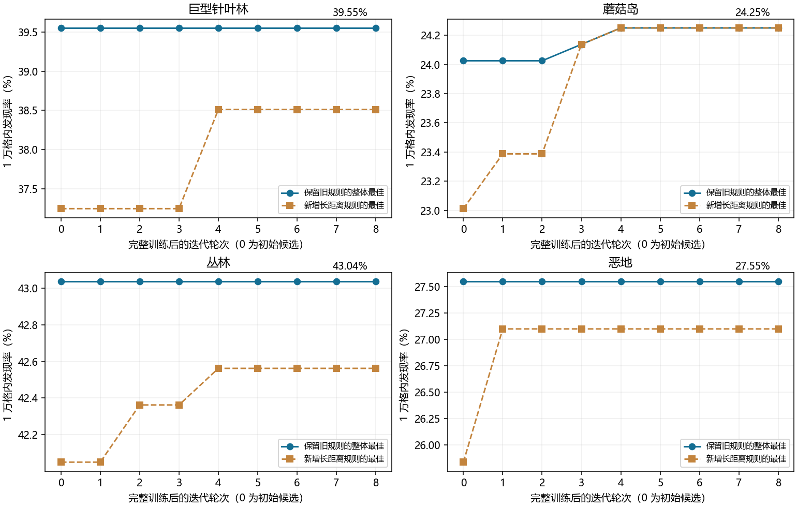

# Minecraft 1.16 稀有群系飞行搜索的阶段结论

用于 Java 1.16.1 全进度攻略中的群系探索环节。研究对象是未知种子条件下，使用鞘翅寻找巨型针叶林、蘑菇岛、丛林和恶地的路线选择。

**可以阶段结案：缺蘑菇岛时，优先扩大未探索海域的覆盖；巨型针叶林和丛林优先扩大新陆地覆盖；恶地可保留向沙漠、热带草原方向的轻微偏好。现有实验没有证明任何方案是唯一最优解，也没有证明更复杂的航点规则优于已有搜索器。**

## 作者结合实战对 AA 速通者的建议

结合我的实战经验，我建议 AA（全进度）速通者不要因为恶地、丛林或巨型针叶林的少量线索就调整整体路线，这些线索不值得干扰其他主线任务。不要把寻找地形作为整条 AA 路线的主线，尽量顺路完成群系搜寻；在本研究的四类目标中，额外增加海洋搜索最明确的收益来自蘑菇岛，因此只有仍缺蘑菇岛时，才值得为这一目标特别提高海上飞行的优先级。

这是作者对 AA 整体路线的实战取舍建议；单目标实验没有直接验证全进度总耗时的收益。

## 可以直接采用的粗规则

| 当前缺少的目标 | 实用规则 | 证据强度 |
|---|---|---|
| 蘑菇岛 | 偏向新海域，避免重复扫同一片海；海岸作为方向线索，不必始终贴岸 | 两组独立验证均有明显收益，是最值得单独改变搜索方向的目标 |
| 巨型针叶林 | 优先新陆地，针叶林线索可作弱提示，保持较直接的路线 | 复杂规则相对直飞的优势没有在第二组验证复现 |
| 丛林 | 优先新陆地，少重复、少无效绕行 | 没有稳定超过简单覆盖搜索的专用技巧 |
| 恶地 | 覆盖新区域，并轻微偏向沙漠、热带草原 | 对随机直飞有小幅重复改善；对覆盖优先的优势未稳定复现 |

找到蘑菇岛后，若剩余任务仅是另外三类稀有群系，可以降低海洋搜索优先级。若仍缺海洋变种或其他海上任务，则继续安排海上探索。F3 坐标用于记住已探索路线，不提供稀有群系的固定方向。

这些自然语言规则是对程序策略的简化；玩家按粗规则执行的发现率没有单独验证。

## 两组独立验证

每组 5000 个新种子，飞行预算 10000 格，圆形视野半径 512 格。下表使用两组中完全相同的旧单目标搜索器，避免把新规则的增量与旧策略的收益混在一起。

| 目标 | A 组直飞 | A 组固定搜索器 | A 组差值 | B 组直飞 | B 组固定搜索器 | B 组差值 |
|---|---:|---:|---:|---:|---:|---:|
| 巨型针叶林 | 36.78% | 39.14% | +2.36 pp | 38.36% | 38.32% | −0.04 pp |
| 蘑菇岛 | 15.72% | 23.46% | +7.74 pp | 14.34% | 23.44% | +9.10 pp |
| 丛林 | 40.28% | 42.48% | +2.20 pp | 42.24% | 42.16% | −0.08 pp |
| 恶地 | 24.60% | 26.88% | +2.28 pp | 24.82% | 26.78% | +1.96 pp |

pp 表示百分点。两组分别分析，没有合并成一次预先设计的 10000 种子验证。A 组是已完成验证的单目标补充分析；B 组的固定搜索器复核为结案补充分析。[配对区间和检验见证据说明](docs/evidence.md)。

## 完整 1 万格优化的结果

另一次训练加入长距离推进、局部纠偏、线索探查和退出规则。在 8000 个训练种子上进行 8 轮持续迭代，共评估 140 个候选，每个候选都覆盖完整训练集。选中的四个策略在 B 组验证前冻结。

最终只有蘑菇岛采用新版本：训练成功数从 1922/8000 提高到 1940/8000；B 组发现率从 23.44% 提高到 23.98%，增加 0.54 个百分点，95% 配对区间为 −0.56～+1.66 个百分点。新增收益尚未确认。其他三类保留旧搜索器。

区域平均面积较大这一逻辑值得检验，但本轮没有转化为可靠的额外搜索收益。对现有规则继续做同类小幅微调，可以在此暂停。

## 接入 1.16.1 全进度攻略

本实验的“找到”是目标进入理想 512 格视野；游戏进度要求玩家实际进入指定群系。发现目标后，应飞入对应群系并按具体 ID 确认进度。

1.16.1 的“探索的时光”要求 42 个具体群系分别满足位置条件。巨型针叶林、蘑菇岛、丛林和恶地在实验里被合并成四个家族；找到某个家族不等于收齐它的所有必需子群系。海洋变种也在进度清单中。[原版进度定义的可读镜像](https://raw.githubusercontent.com/InventivetalentDev/minecraft-assets/1.16.1/data/minecraft/advancements/adventure/adventuring_time.json)，[42 个群系检查清单及原版文件校验](docs/biome_checklist_1.16.1.md)。

因此，建议攻略采用“未探索覆盖为默认路线，缺蘑菇岛时增加海洋优先级，恶地保留弱地形偏好；发现家族后逐项补齐需要的子群系”这一规则。

## 适用范围

路线实验使用 Cubiomes 的 Java 1.16.5 默认主世界模型，4 格群系采样，固定起点，16 个候选方向和理想视野；已核对 1.16.1 的进度定义，没有完成本轮路线的 1.16.1 原版客户端复现。这里的百分比是模拟发现率，不能当作 1.16.1 实际进度完成率。

研究没有计入烟花、飞行安全、寻找结构和生物、补齐所有子群系，以及其他进度任务的机会成本。也没有以全部进度总耗时为目标训练。有限规则搜索不能证明全局最优，“没有发现额外收益”不等于“其他技巧永远无效”。

## 文件与复核

- [证据说明](docs/evidence.md)：逐组配对比较、置信区间、检验口径和结案判断。
- [1.16.1 群系清单](docs/biome_checklist_1.16.1.md)：42 项要求及原版服务器文件来源。
- [复现与发布说明](docs/publication.md)：轻量摘要包与完整研究包的区别。
- `data/`：原始汇总、固定规则、第二组距离数组、训练及两组验证种子清单。
- `MANIFEST.json`：上传包内文件的 SHA-256 校验。

运行 `python tools/verify_summary.py` 可核对文件、数值、种子不重叠和本地文档链接。该检查不重新生成游戏地图或训练策略。
